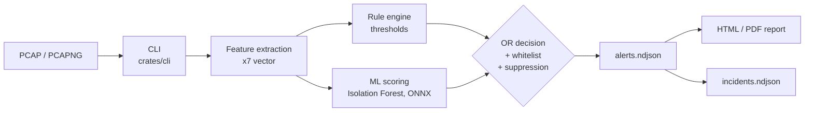

# DNS Tunneling Detection


**English** | [Türkçe](README.tr.md)

An offline DNS tunneling detector written in Rust. It reads a recorded PCAP/PCAPNG file, extracts per-query features, scores them with both a threshold-based rule engine and an ONNX Isolation Forest model, and writes alerts as NDJSON. The repository also ships a "5 bad / 5 good" scenario that validates the detector automatically.

NDJSON (Newline Delimited JSON) stores exactly one JSON object per line, which keeps the output easy to stream and pipe.

## Contents

- [How it works](#how-it-works)
- [Quick start](#quick-start)
- [Repository layout](#repository-layout)
- [ONNX Runtime setup](#onnx-runtime-setup)
- [Test files](#test-files)
- [End-to-end pipeline](#end-to-end-pipeline)
- [Reproducibility and validation](#reproducibility-and-validation)
- [Performance and limitations](#performance-and-limitations)
- [Troubleshooting](#troubleshooting)
- [Security and privacy](#security-and-privacy)
- [Roadmap](#roadmap)

## How it works



For every DNS event the CLI computes seven features and runs two independent decision sources: a threshold-based rule engine and an Isolation Forest model. The final decision is an OR: **ALARM = rule triggered ∨ ML says anomaly**. Domains that match the whitelist never raise an alarm.

## Quick start

```powershell
# 1) Analyze the demo capture
$pcap = ".\data\dns-lab-10q.pcapng"
cargo run --bin cli -- --mode batch --pcap "$pcap" --config "config\demo.toml" --out "target\alerts.ndjson"

# 2) Quick summary (optional)
Get-Content "target\alerts.ndjson" | ConvertFrom-Json |
  Sort-Object score -Descending |
  Format-Table qname, @{n='score';e={"{0:N2}" -f $_.score}}, reasons

# 3) Automatic validation (expected result shown below)
powershell -ExecutionPolicy Bypass -File .\scripts\assert-5v5.ps1
# The script prints its summary in Turkish ("ÖZET"):
# ÖZET -> badOK:True  goodOK:True  reasonVariety(>=3):True
```

Expected behavior:

- The 5 "bad" domains each raise an alarm, with different combinations of `reasons`.
- The 5 "good" domains raise no alarm.
- At least 3 different reason combinations appear (for example `len+entropy`, `txt_ratio`, `nxdomain_ratio`, `qps_client`, `unique_sub_ratio`).

Note: the model-based scoring needs ONNX Runtime, see [ONNX Runtime setup](#onnx-runtime-setup).

## Repository layout

```text
.
├── crates/
│   ├── cli/        # command-line entry point and decision logic
│   ├── collector/  # PCAP reading
│   ├── features/   # feature extraction and windowing
│   ├── rules/      # threshold-based rule engine
│   ├── ml/         # ONNX Isolation Forest wrapper
│   └── sink/       # output
├── config/         # TOML thresholds, whitelist, ML settings
├── data/           # sample captures (lab and normal traffic)
├── models/         # Isolation Forest models (ONNX)
├── ml/             # model training script
├── scripts/        # PowerShell helpers (capture, validation)
├── tools/          # report and incident generation, ONNX helpers
├── tests/          # scenario manifest and runners
├── schemas/        # event card JSON schema and samples
└── evidence/       # recorded command outputs
```

## ONNX Runtime setup

The ML scoring step loads `onnxruntime.dll` at runtime. The runtime is not stored in this repository, so download it once:

1. Download `onnxruntime-win-x64-1.22.1.zip` from the [ONNX Runtime v1.22.1 release](https://github.com/microsoft/onnxruntime/releases/tag/v1.22.1).
2. Extract it so that the DLL ends up at:

   ```text
   runtime/onnx-1.22.1/onnxruntime-win-x64-1.22.1/lib/onnxruntime.dll
   ```

3. Make sure `ml.model_path` in your config points to `models/iforest.onnx`.

## Test files

| File | Purpose |
| --- | --- |
| `data/dns-lab-10q.pcapng` | Demo PCAP containing 5 "bad" queries (alarm expected) and 5 "good" queries (no alarm expected). |
| `data/dns-lab-10q.json` | Reference lists of "bad" and "good" names; the assert script reads it. |
| `config/demo.toml` | Thresholds and whitelist (for example `min_entropy`, `min_domain_len`, `txt_ratio`, `nxdomain_ratio`, `qps_client`, `unique_sub_ratio`). |
| `scripts/assert-5v5.ps1` | Automatic check: "5 bad = alarm", "5 good = no alarm", and at least 3 distinct reasons. |
| `target/alerts.ndjson` | Analysis output, one JSON record per line. |

The "bad" names use the `.invalid` TLD. It is reserved for special use and queries are expected to return NXDOMAIN, which makes the test safe and repeatable.

## End-to-end pipeline

This section walks through the full chain: capture → convert → analyze → report. The goal is that a reviewer or a new engineer can run the system, verify the results and produce evidence by reading this text alone. Everything can be done manually without modifying any code.

### 1) Capture traffic (optional, a ready PCAP is included)

- On Windows, DNS (UDP/53) traffic can be captured with the built-in `pktmon` tool. `scripts/capture-with-pktmon.ps1` enables the filter, simulates a short browsing session, then stops the capture and converts the ETL file to `.pcapng`. Run PowerShell as Administrator for this script.
- Ready-made files are included so that live capture is not required: `data/dns-lab-10q.pcapng` (short, with both bad and good examples), `data/good-normal.pcapng` and `data/good-spotify.pcapng`.
- Live streaming mode may be added later; this repository focuses on offline PCAP analysis.

### 2) Convert (ETL → PCAPNG)

- If you captured traffic yourself, convert the `PktMon.etl` produced after `pktmon start/stop` with `pktmon pcapng PktMon.etl -o data\live-<ts>.pcapng`. If your platform does not support that command, use `pktmon etl2pcap`.
- Verify the result with `Test-Path data\live-<ts>.pcapng`; the CLI analysis then runs on that file.

### 3) Analysis engine (Rust CLI)

Basic command pattern:

```powershell
cargo run --bin cli -- --mode batch --pcap <file.pcapng> --config config\demo.toml --out target\alerts.ndjson
```

Flags:

- `--pcap`: PCAP/PCAPNG file to analyze.
- `--config`: thresholds, whitelist and ML settings.
- `--out`: NDJSON output path (one alert per line).
- `--suppress-secs N`: suppression window for repeated alerts with the same `(root, qtype)`; default 60 s. It collapses consecutive alerts from the same root into one line.

Internals in short: `crates/cli/src/main.rs` reads the PCAP records, extracts features for each DNS event (feature engineering) and runs two decision sources in parallel: (1) the threshold-based rule engine and (2) ML (Isolation Forest). The final decision uses an OR: **ALARM = rule triggered ∨ ML says anomaly**. No alarm is produced for roots that match the whitelist.

#### 3.1 Feature vector (x7)

Seven features are extracted from each DNS record:

- `domain_len`: length of the domain name
- `shannon_entropy (H)`: measure of character variety and randomness
- `label_count`: number of labels (`a.b.c` → 3)
- `txt_ratio`: share of TXT queries within the window
- `nxdomain_ratio (nx)`: share of NXDOMAIN/servfail answers
- `qps_client (qps)`: queries per second per client
- `unique_sub_ratio (uniq_sub)`: share of unique subdomains in the window

Note: window-based metrics (the ratio features) currently use a fixed 60-second window internally. This may become a parameter in later versions. `--suppress-secs` is independent of it; it is the repeat-alert suppression window.

#### 3.2 Whitelist

- If a name matches `whitelist.domains` in `config/*.toml` (for example `spotify.com`, `.arpa`), no alarm is written, even if the rules and the ML model would flag it. Matching is an ASCII case-insensitive suffix match.

#### 3.3 Rule engine

- The `crates/rules` module sums a score according to the `Thresholds` configuration and adds every criterion that crosses its threshold to the `reasons` list. Example labels: `len>=min`, `entropy>=min`, `txt_ratio>=min`, `nxdomain_ratio>=min`, `qps>=min`, `unique_sub>=min`.
- When the rule score exceeds `score_alert`, the rule is considered triggered.

#### 3.4 ML scoring (ONNX Isolation Forest)

- Model: `models/iforest.onnx`. ONNX Runtime is expected under `runtime/onnx-1.22.1/...` (see [ONNX Runtime setup](#onnx-runtime-setup)).
- The `MlIf` wrapper loads the model lazily and scores the `x7` vector of every record. It compares the score with `ml.score_threshold` to decide whether the record is an anomaly. If it is, `ml_iforest` is added to `reasons` and the `reason` field can be `ml` or `both`.

#### 3.5 Decision and suppression

- OR logic: **ALARM = (rule triggered) ∨ (ml_is_anomaly)**.
- Dedup/suppress: within buckets defined by `--suppress-secs` (bucket = `event_ts / N`), a single alert is written per `(root, qtype)`. This keeps noise under control. With 5 s, repeats appear sooner (the count may rise); with 30 s they appear less often (the count may fall).

#### 3.6 NDJSON output

- Each line is one JSON object with `ts`, `mode`, `score`, `reason` and `reasons` (labels), together with the DNS fields (`qname`, `root`, `qtype`) and the features (`domain_len`, `entropy`, `txt_ratio`, `nx_ratio`, `qps_client`, `unique_sub_ratio`). When ML is on, `ml_score` and `ml.threshold` are written as well.

### 4) Reporting (HTML/PDF)

- `tools/report_html.ps1` reads the NDJSON and produces `target/report.html`. The top of the page summarizes total alerts, distinct roots, label diversity and the ML threshold; the table lists every alert with its details and label pills.
- For a PDF, use Edge/Chrome "Print to PDF" or headless `--print-to-pdf`. For presentations, a screenshot of the first page is the quickest option.

### 5) Incident enrichment

- `tools/render_incidents.ps1` writes `target/incidents.ndjson` from `target/alerts.ndjson` and adds these metadata fields: `model_sha256`, `build_id` (exe ProductVersion / git SHA / short exe SHA-256), `ort_version`, and masked IPs (`src_ip_masked`, `dst_ip_masked`).
- This file is useful for traceability, pre-delivery auditing and proving that model and version match.

### 6) Running a manifest (multiple scenarios)

- Each line in `tests/manifest.ndjson` is a job definition with the fields `{"name","pcap","label","config"}`.
- `tests/run_manifest.ps1` iterates over the list, runs the CLI for every scenario and produces `report.html` and, when possible, a PDF. At the end it prints a short summary table and copies the last report to `target/report.html` for quick viewing in an IDE.

### 7) Configuration (TOML)

- `config/demo.toml` holds the demo thresholds and whitelist. Examples:
  - `min_domain_len`, `min_entropy`, `min_txt_ratio`, `min_nxdomain_ratio`, `min_qps_client`, `min_unique_sub_ratio`
  - `ml.mode = "onnx"`, `ml.model_path`, `ml.score_threshold`
- Note: the internal feature window is currently fixed at 60 seconds; `--suppress-secs` is the repeat-alert suppression window. They are different concepts.

### 8) File naming and structure

- Analysis output: `alerts.<scenario>.ndjson` (`target/alerts.ndjson` for a single run).
- Report: `report_<scenario>.pdf` and/or `report.<scenario>.html`.
- Incidents: `target/incidents.ndjson`.
- Model and runtime: `models/`, `runtime/onnx-1.22.1/...`.

### 9) Evidence set (screenshots)

- Terminal: the command you ran plus a short output in the same frame, for example `cargo run ...` followed by `[OK] MODE=batch | pcap=... | config=...` and the alert count from `Get-Content ... | Measure-Object`.
- Report: a screenshot of the first page of `report.html` showing "Total alerts", "Top roots", "Reason distribution" and the start of the table.
- Incidents: after `tools\render_incidents.ps1`, show "OK: wrote target\incidents.ndjson" and the first 1–3 lines of the file (model, build and ORT version).
- Version and traceability: the output of `git rev-parse --short HEAD` and `(Get-FileHash models\iforest.onnx -Algorithm SHA256).Hash`.
- Configuration visibility: the critical lines of `config\demo.toml`; only view the file (do not change it) and take a screenshot.

## Reproducibility and validation

- Running with the same PCAP and config yields the same scores and labels. The `ts` field in the NDJSON depends on system time and can naturally differ.
- `scripts/assert-5v5.ps1` validates against the lab list automatically: bad names must alarm, good names must not, and at least 3 distinct reason combinations are expected.

### Quick start: bad and good examples

1. Bad (lab):

   ```powershell
   cargo run --bin cli -- --mode batch --pcap data\dns-lab-10q.pcapng --config config\demo.toml --out target\alerts.bad_exfil_demo.ndjson
   ./tools/report_html.ps1 -alerts target\alerts.bad_exfil_demo.ndjson -out target\report.bad_exfil_demo.html
   ```

2. Good (normal):

   ```powershell
   cargo run --bin cli -- --mode batch --pcap data\good-normal.pcapng --config config\demo.toml --out target\alerts.good_normal.ndjson
   ./tools/report_html.ps1 -alerts target\alerts.good_normal.ndjson -out target\report.good_normal.html
   ```

### Presentation tips

- Show clear single-page frames: command plus output, the first page of the report, the first lines of incidents and the critical config lines. Show the file naming convention (`alerts.<scenario>.ndjson` / `report_<scenario>.pdf`) with a file explorer screenshot.
- To demonstrate reproducibility, run the same "bad" analysis twice and capture that the "label count" and "most frequent combination" outputs are identical.

## Performance and limitations

- This demo is written with readability and auditability in mind. Under load, further optimizations such as parallel reading, batch inference and I/O improvements can be considered.
- Root domain extraction is a simple eTLD+1 approach; production systems should enrich it with the Public Suffix List.
- The window length is fixed internally; making it a CLI parameter is a candidate for future work.

## Troubleshooting

- **`pwsh` is not recognized:** if you are in Windows PowerShell, run scripts with `.<path>\script.ps1`; if needed, use `Set-ExecutionPolicy -Scope Process -ExecutionPolicy Bypass`.
- **ONNX Runtime could not be loaded:** check the path `runtime/onnx-1.22.1/.../onnxruntime.dll` and the architecture (win-x64).
- **No PDF produced:** if Edge/Chrome is not found, use "Print to PDF" from the browser with `report.html` open.
- **5 s vs 30 s comparison shows no difference:** your PCAP may have no repeated events for the same `(root, qtype)`; with a single event the suppression window naturally makes no difference.

## Security and privacy

- IPs are masked in incidents (IPv4 last octet `x`, IPv6 `::x`). The `.invalid` TLD is for testing and cannot collide with real system names.

## Roadmap

- Make the analysis window configurable from the CLI (5 s / 10 s / 30 s) and show it in the report.
- AND / OR / weighted combinations in the decision logic, plus calibration tools.
- Central whitelist/blacklist management, live monitoring dashboards and multi-model support.

This document brings the end-to-end architecture, the decision mechanism and the evidence workflow together in one place. With the same inputs it produces the same results and is easy to prove with screenshots: capture → convert → analyze → report.
